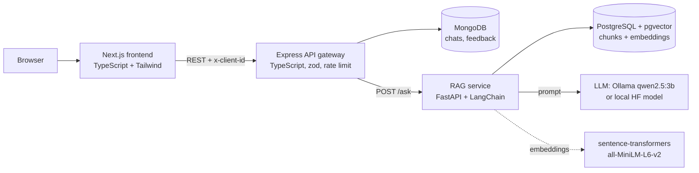
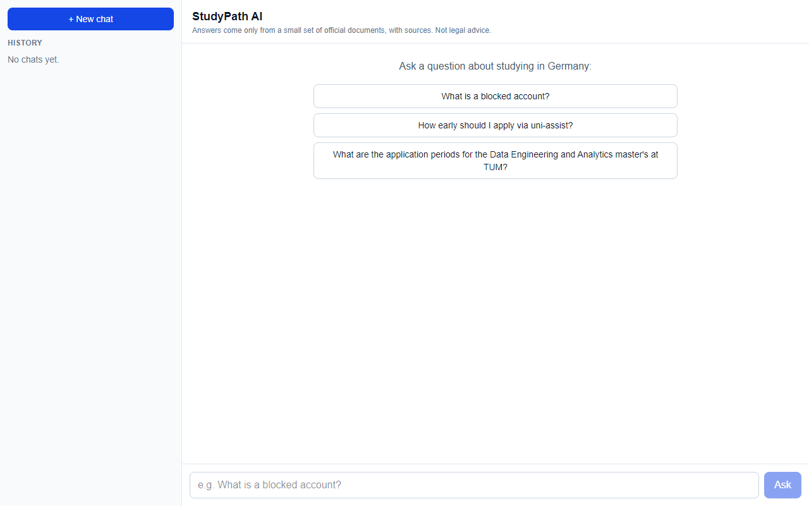
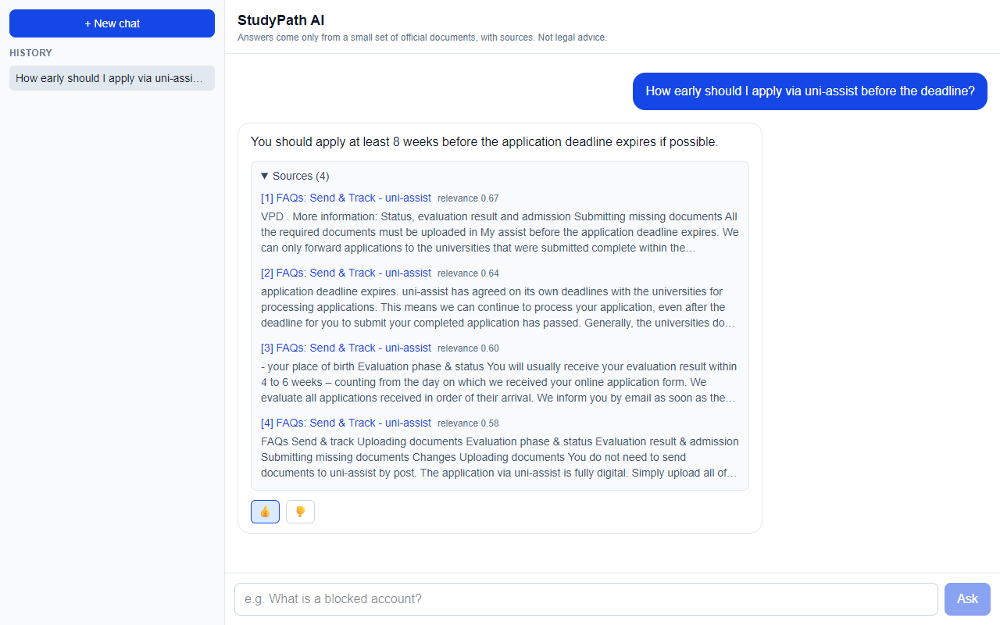
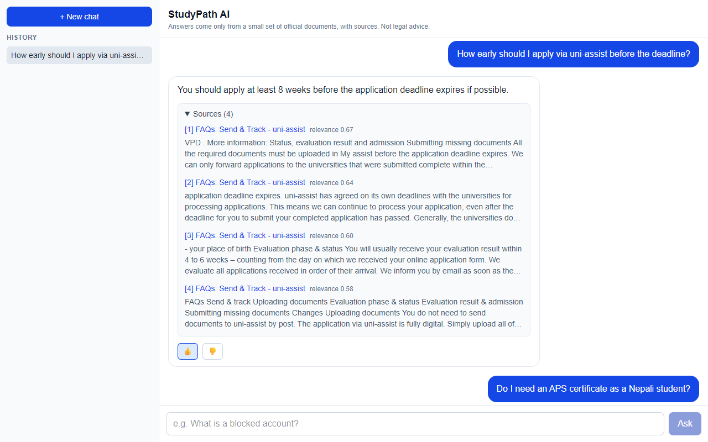
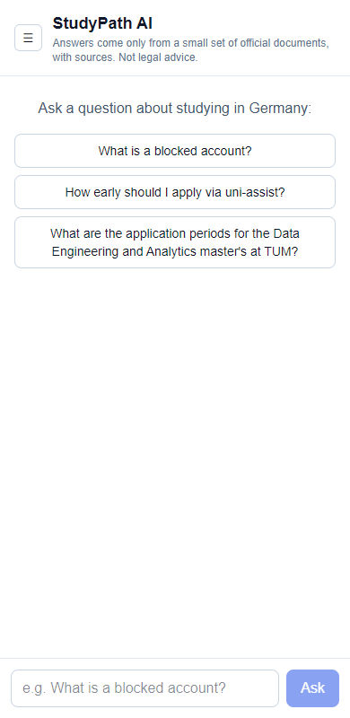

# StudyPath AI: RAG-Based Study-Abroad Assistant

[](https://github.com/swostik720/studypath-ai/actions/workflows/ci.yml)

A retrieval-augmented generation (RAG) assistant that answers questions about studying in Germany
**only from a small collection of public official documents** and shows the sources under every answer.
If the documents do not contain the answer, it says so instead of guessing.

It is an open-source, more advanced version of the chatbot I built for an educational consultancy
(Global Journey, globaljourneyedu.com.np). The document collection here is tiny (10 pages), so this is a
demonstration of the engineering, not a complete advisory service. **It is not legal or visa advice.**

## Architecture



| Part | Tech | Responsibility |
|---|---|---|
| `frontend/` | Next.js, TypeScript (strict), Tailwind | chat UI, loading state, cited sources, history, thumbs up/down |
| `gateway/` | Node.js, Express, TypeScript, zod, Mongoose | validation, rate limiting, error handling, stores chats/feedback in MongoDB |
| `rag-service/` | Python, FastAPI, LangChain, Hugging Face | load -> split -> embed -> pgvector; retrieve, relevance gate, prompt, LLM |
| PostgreSQL + pgvector | `pgvector/pgvector:pg16` | chunk text, source URL, 384-d embeddings, HNSW cosine index |
| MongoDB | `mongo:7` | conversations and feedback (no accounts: an anonymous browser UUID owns chats) |

### How a question flows
1. The frontend sends `POST /api/chat {message, chatId?}` with an `x-client-id` header.
2. The gateway validates it (zod), calls `POST /ask` on the RAG service, and stores both messages in MongoDB.
3. The RAG service embeds the question, fetches the top-4 chunks from pgvector, and checks the best cosine
   similarity against `MIN_SCORE`. Too low -> "I don't know" without calling the LLM.
4. Otherwise the chunks are put in a prompt that tells the LLM to answer only from them (or say "I don't know");
   the answer is returned with the source titles, URLs and chunk text.

## Document collection
10 public pages, stored as plain text in [rag-service/corpus/](rag-service/corpus/) with the URL of each
(`sources.json`): the Federal Foreign Office (blocked account, visa FAQ), uni-assist (application steps, documents,
upload, FAQs) and one TUM master's programme page. Retrieved on 2026-10-13 with `scripts/fetch_corpus.py`.
Pages remain the property of their publishers; they are included for research/demonstration and every answer
links back to the original. DAAD pages could not be downloaded from my network, so DAAD is not in the collection.

## Run with Docker Compose
```bash
cp .env.example .env              # set POSTGRES_PASSWORD
docker compose up --build
```
First start downloads several GB (the `qwen2.5:3b` Ollama model, the embedding model, PyTorch): be patient.
Then open http://localhost:3000. The RAG container ingests the documents into pgvector on every start; ingestion is
idempotent (chunk ids are content hashes, stale chunks are removed, upserts never duplicate).

Services: frontend :3000, gateway :4000, rag (internal) :8000, postgres, mongo, ollama.

### Run without Docker (development)
```bash
# RAG service (database-free mode, local Hugging Face model instead of Ollama)
cd rag-service && pip install -r requirements.txt --extra-index-url https://download.pytorch.org/whl/cpu
VECTOR_STORE=memory LLM_PROVIDER=hf uvicorn app.main:app --port 8000
# gateway (needs MongoDB)   cd gateway && npm ci && npm run dev
# frontend                  cd frontend && npm ci && npm run dev
```

## Tests and CI
| Part | Command | What is tested |
|---|---|---|
| RAG service | `cd rag-service && pytest` | chunking, retrieval ranking, "I don't know" (LLM must not be called), idempotent re-ingest, API validation; pgvector integration test (runs in CI against a real pgvector container) |
| Gateway | `cd gateway && npm test` | Vitest + Supertest against a real `mongod`: chat flow, validation, ownership, feedback, RAG outage -> 502, rate limit, JSON errors |
| Frontend | `npm run lint && npm run build` | type-checks and builds |

GitHub Actions (`.github/workflows/ci.yml`) lints and tests the Python and TypeScript parts, then builds all images.

## Evaluation
See [EVALUATION.md](EVALUATION.md) for the full tables and every answer.

30 questions I wrote from the documents (24 answerable, 6 not answerable), LLM `ollama:qwen2.5:3b` on CPU:

| Measure | Result |
|---|---|
| Retrieval: correct source ranked 1st (answerable) | 23 / 24 (hit@1 = hit@4 = 0.958, MRR 0.958) |
| Answerable questions with a correct answer (automatic key-fact check) | 18 / 24 |
| Unanswerable questions correctly refused ("I don't know") | 6 / 6 |
| Mean time per answer | 30 s |

Retrieval is strong; the weakness is the small 3B model, which wrongly said "I don't know" on 5 answerable
questions even though the right document had been retrieved. The relevance-score gate only catches off-topic
questions. Details, every answer and the error analysis are in [EVALUATION.md](EVALUATION.md).

## Screenshots





## Limitations
- Only 10 pages: most questions are out of scope by design. Facts can change; always check the official source.
- 30 evaluation questions written by me, automatic key-fact scoring, single run, small local model.
- The relevance gate only catches off-topic questions; on-topic questions that the documents do not answer rely on the
  LLM refusing, which small models do imperfectly (see EVALUATION.md).
- No user accounts: chats belong to an anonymous browser id, so clearing browser storage loses access to history.
- No streaming: the UI shows a loading state while the (CPU) LLM answers, which can take tens of seconds.

## What I learned
- RAG quality is mostly retrieval quality: chunking and the "answer only from context" gate matter more than the model.
- A similarity threshold cannot tell "on-topic but not in the documents" from "answerable"; I measured that instead of assuming it.
- Idempotent ingestion (content-hash ids + deleting stale chunks) makes re-running safe.
- Putting an anonymous owner id and validation at the gateway keeps the Python service simple.
- Testing against real infrastructure (a real mongod, a pgvector container in CI) finds problems mocks hide.
